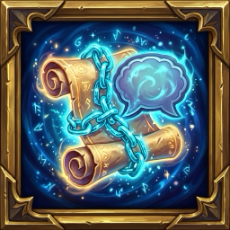

# Forever Chat Utilities

A lightweight, zero-taint World of Warcraft addon built for **World of Warcraft: Forever** (`Interface: 16001` / `16000`, `camelot` game type) with two focused features:

1. **Open any chat frame in a new window to copy text.**
2. **Make links posted in chat clickable**, opening an external web navigation confirmation dialog (with optional automatic browser launch via a local companion helper).

## Features

- **Chat Copy Window (`ForeverChatUtilitiesFrame`)**
  - Movable and resizable popup window containing a scrollable multi-line text box.
  - **Mode: Copy Text** (default): Unwraps hyperlinks so you can drag-select any text, URL, player name, or message and press `Cmd+C` (macOS) or `Ctrl+C` (Windows). Includes a one-click **Select All** button.
  - **Mode: Click Links**: Keeps links interactive inside the copy window so you can click URLs or hover/click game links (items, spells, quests, achievements).
  - **Colors: ON / OFF**: Toggle between preserving chat colors or stripping color codes for plain-text copying.
  - **Refresh**: Re-reads the latest lines from the active chat frame.
- **Clickable Chat Links & External Web Navigation Dialog**
  - Automatically detects web links (`https://...`, `http://...`, `www....`, `discord.gg/...`, `wowhead.com/...`, `wago.io/...`, etc.) in incoming chat messages without corrupting existing WoW item/spell/player links or false-matching numbers like `5.5k` or patch versions like `1.60.1`.
  - Clicking a URL opens the **Navigate to External Web Page** dialog showing a warning icon, the destination domain, and the pre-highlighted URL (`https://` added automatically if omitted).
  - Press **`Cmd+C`** / **`Ctrl+C`** to copy the link (the dialog automatically closes right after copying), or press **`Esc`** / **Cancel** to dismiss.
  - **`Shift + Click`** a URL while a chat input box is open to insert it into your message.

## Why Isn't the Browser Opened Directly from Lua?

World of Warcraft's Lua sandbox intentionally blocks addons from launching external applications or opening arbitrary web pages (`LoadURLIndex` only works for hardcoded internal Blizzard support IDs, and `CopyToClipboard` is protected against addon invocation).

To give you **one-step browser opening** while staying 100% compliant with WoW's sandbox:
1. Click any link in chat → the **Navigate to External Web Page** dialog opens with the URL pre-selected.
2. Optionally run the lightweight companion script included in this addon folder while playing:
   - **macOS:** `./open-links-helper.sh`
   - **Windows (PowerShell):** `powershell -ExecutionPolicy Bypass -File .\open-links-helper.ps1`
3. Whenever World of Warcraft is the active window and you press **`Cmd+C`** / **`Ctrl+C`** in the dialog, the companion helper detects the copied `http://`/`https://` URL and opens it in your default web browser automatically.

## Installation

Copy the `ForeverChatUtilities` folder into your World of Warcraft Forever AddOns directory:

- **macOS:** `/Applications/World of Warcraft/_forever_/Interface/AddOns/ForeverChatUtilities` (or `_classic_era_` if applicable)
- **Windows:** `C:\Program Files (x86)\World of Warcraft\_forever_\Interface\AddOns\ForeverChatUtilities`

Ensure the folder contains:
- `ForeverChatUtilities.toc`
- `ForeverChatUtilities.lua`
- `Icon.png`

Restart the client or run `/reload` in-game.

## Controls & Slash Commands

- **Copy Button:** Click the small note button in the top-right corner of any chat frame:
  - **Left-Click:** Open or toggle the Chat Copy Window.
  - **Right-Click:** Open the Chat Copy Window directly in **Click Links** mode.
- **Addon Compartment:** Click **Forever Chat Utilities** in the minimap Addon Compartment dropdown (`Left-Click` for Copy Text, `Right-Click` for Click Links).
- **Chat Tab Shortcut:** `Shift + Left-Click` any chat tab (including the Combat Log or whisper tabs) to open its contents in the Chat Copy Window.
- **Slash Commands:** `/fcu`, `/cc`, `/chatcopy`, or `/copychat` opens the Chat Copy Window for the currently active chat tab.

## License

This project is licensed under the [MIT License](LICENSE). Attribution is required when reusing or redistributing this code.
